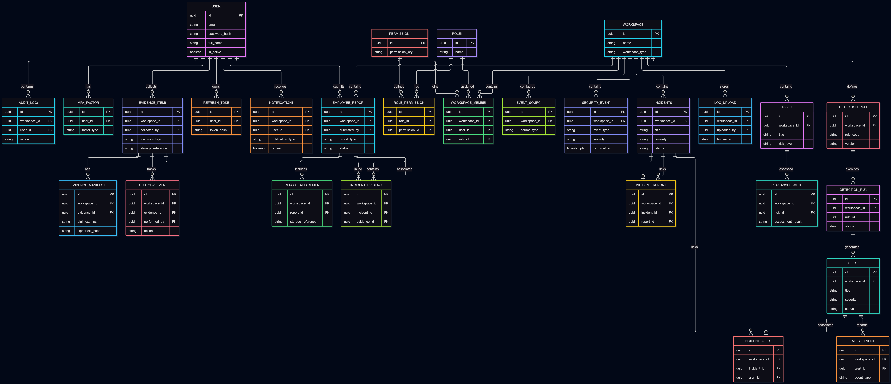

ERYNDOX – Entity Relationship Diagram

Project: ERYNDOX – Cyber Intelligence & Digital Forensics
Version: 1.0
Reference: SRS v1.3

1. Introduction

This document presents the Entity Relationship Diagram (ERD) of ERYNDOX. It illustrates the main database entities, their primary keys, foreign keys, and relationships using Crow’s Foot Notation.

2. ER Diagram
